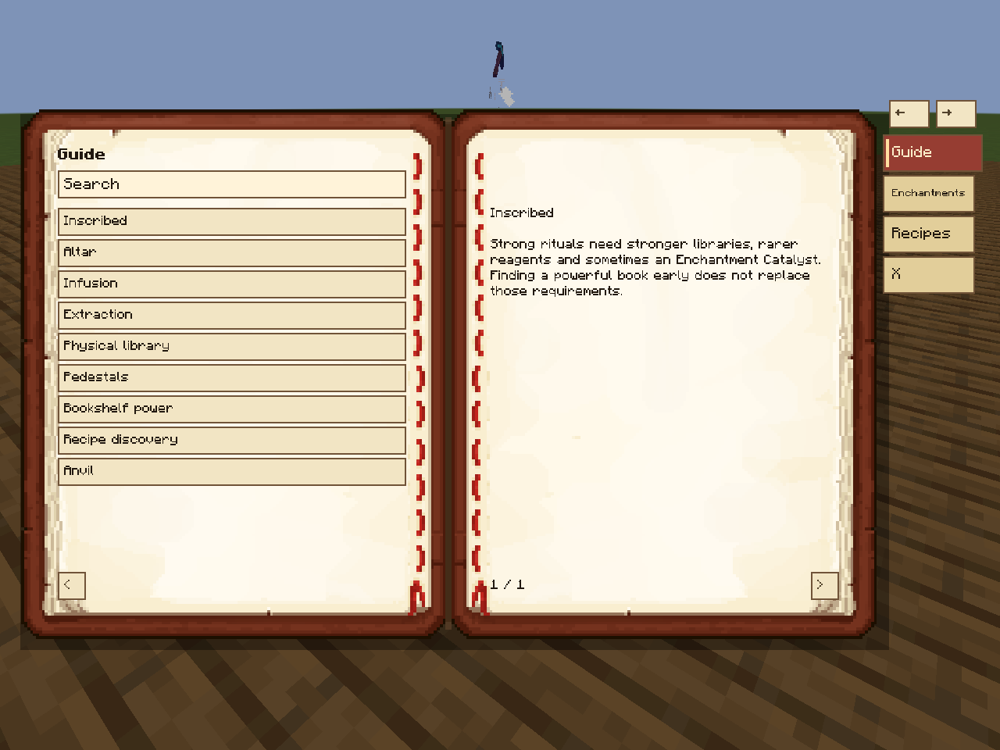

# Inscribed 0.7.3

Version 0.7.3 updates the guide and altar inspection book geometry, paper theme, responsive layout and English/Portuguese text. Ritual mechanics, recipe/loot content and defaults retain the stable 0.7.2 behavior. See [release notes](docs/RELEASE_NOTES_0.7.3.md), [build instructions](docs/INSCRIBED_DEV_SETUP.md), [compatibility](docs/INSCRIBED_COMPATIBILITY.md) and [recipe coverage](docs/INSCRIBED_RECIPE_COVERAGE_FINAL.md). Historical RC evidence is retained in `docs/rc08`.

Enchanted Books are physical knowledge. Place them in Chiseled Bookshelves, gather reagents on Infusion Pedestals, and use the Enchanting Table to infuse or extract enchantments.

## Installation

Minecraft **1.21.1**, **NeoForge 21.1.255 or newer**, and **Java 21** are required. Place the Inscribed JAR in `mods` on the client and server. Optional integrations: JEI 19.57.0.451 (client), LSBC 0.22.1, and Create 6.0.10. No optional mod is required to play.

## Core loop

1. Find enchanted books and store them in nearby Chiseled Bookshelves.
2. Place the target item on an Enchanting Table with right click.
3. Put one reagent on each nearby Infusion Pedestal. Recipes use at most eight pedestals.
4. Supply Bookshelf Power with ordinary bookshelves, then Shift + right click the table to start.
5. Retrieve the result with an empty main hand.

Infusion applies the recipe's exact level, using a matching physical book. It uses neither XP nor lapis. When multiple infusion recipes match, the selector shows the valid choices. Extraction is selected by pedestal ingredients, without a selection interface. The default recipes have **20% extraction failure**: failure consumes reagents and the empty book and removes the selected enchantment without producing a book. Cancellation consumes nothing.

## Physical Library and Pedestals

Defaults: bookshelves and physical library within five blocks horizontally, pedestals within four; vertical range is two blocks. A stronger book can authorize a weaker recipe, but the output remains the recipe's level. Learning an enchantment reveals eligible recipes; it never replaces the physical book. Pedestals hold one item and require manual interaction. They cannot be moved by pistons or Create contraptions.

## Enchantment Catalyst

Advanced recipes use `inscribed:enchantment_catalyst`, a progression resource found in configured structure loot. Duplicate enchanted books remain useful as library references and replacements for consumed books. The default catalog contains 125 vanilla recipes and six conditional Create recipes. Villager trades remain vanilla.

## Guide and optional integrations

Craft the Guide Book with a book and amethyst shard. It explains rituals and shows discovered enchantments and recipes. JEI adds Infusion and Extraction categories. LSBC adds the Codex Enchantments tab, KnownWords names and magnifying-glass inspection. Without LSBC, Shift + right click with Book and Quill records the altar inspection in the book.

With Create installed, hover the Enchanting Table or Infusion Pedestal item and hold W to open the [animated Ponder setup tutorial](docs/INSCRIBED_CREATE_PONDER.md).

## Datapacks and configuration

Add recipes and loot without changing Java. Start with the [modpack quickstart](docs/INSCRIBED_MODPACK_QUICKSTART.md), then use the [authoring guide](docs/INSCRIBED_DATAPACK_AUTHORING.md), [configuration reference](docs/INSCRIBED_CONFIGURATION.md), [compatibility table](docs/INSCRIBED_COMPATIBILITY.md), and [troubleshooting](docs/INSCRIBED_TROUBLESHOOTING.md).

The server TOML controls global behavior. Datapacks define content. Existing JSON configuration overlays are supported and **take precedence over datapacks** for the same ID. See the configuration reference before replacing default content.

## Release information

[Changelog](CHANGELOG.md), [credits](CREDITS.md), [MIT license](LICENSE), [known limitations](docs/INSCRIBED_KNOWN_LIMITATIONS.md), and [release checklist](docs/INSCRIBED_RELEASE_CHECKLIST.md). Historical implementation reports describe earlier builds; the current release is 0.7.2; RC reports retain their original version labels.

## Official default content

`content/inscribed_default_datapack` is the canonical production Vanilla + Create datapack. The JAR embeds its data and generates editable config mirrors from the same source. `defaultDatapackZip` exports the official standalone pack. Installing that pack overrides the same IDs; examples remain separate and never load as defaults. Explicit JSON configuration entries take precedence over datapacks with the same ID. See the [authoring guide](docs/INSCRIBED_DATAPACK_AUTHORING.md).
