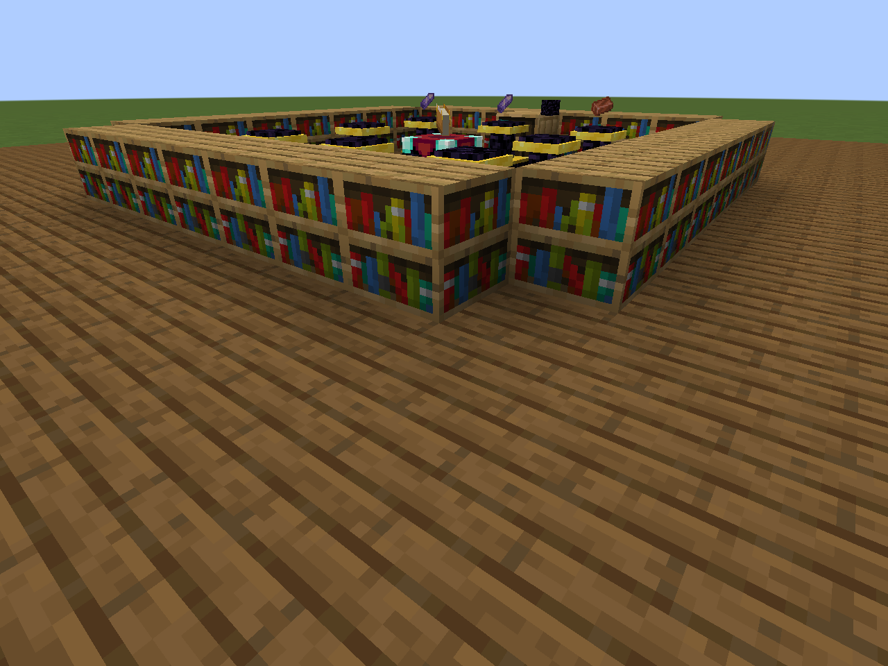
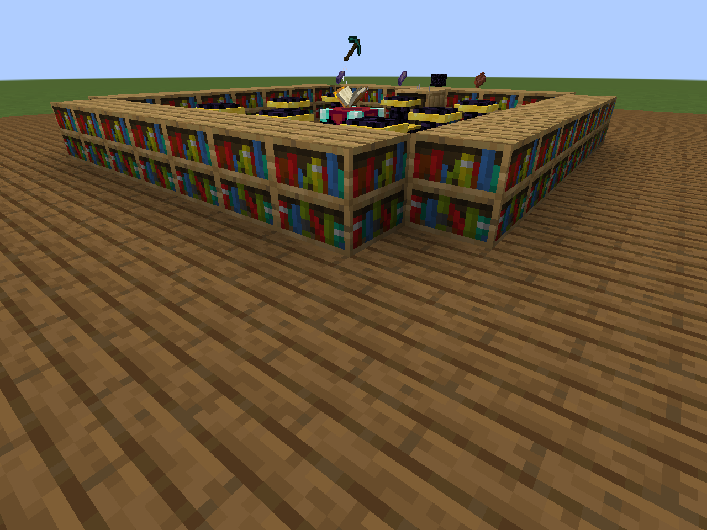
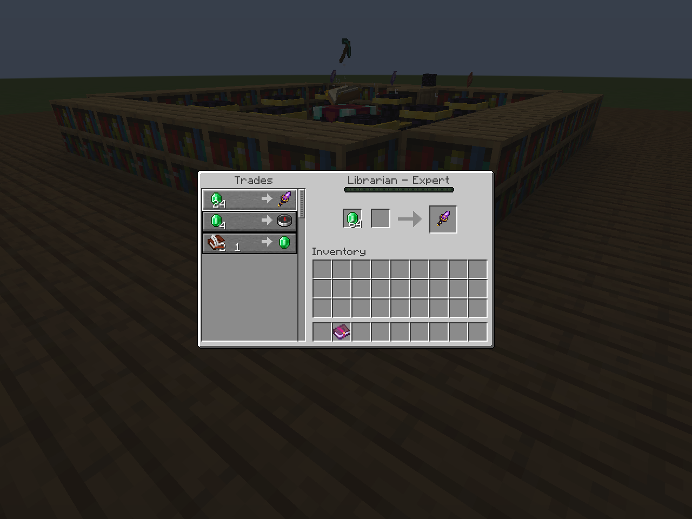
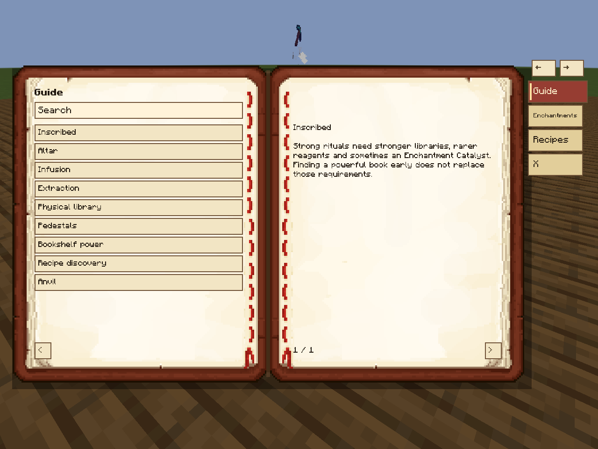

# Inscribed

**Construa uma biblioteca. Prepare os reagentes. Inscreva seu equipamento.**

O Inscribed transforma encantamentos em um ofício físico: você encontra livros, organiza uma biblioteca e prepara rituais numa Mesa de Encantamentos. Livros encantados servem como referências reais. Encantamentos mais fortes exigem uma biblioteca melhor e materiais mais raros, mantendo a exploração e a sala de encantamentos úteis durante a progressão.

Versão preparada: **0.8.0** · Minecraft **1.21.1** · **NeoForge 21.1.255+** · Java **21** · licença **MIT**.

[README em inglês](../README.md) · [Adicionar encantamentos](ADDING_ENCHANTMENTS.pt-BR.md) · [Configurações](INSCRIBED_CONFIGURATION.md)



## Como jogar

1. Instale o JAR nos clientes e no servidor. JEI, Create/Ponder e LSBC são integrações opcionais.
2. Fabrique o Guia do Inscribed com livro e fragmento de ametista.
3. Monte uma Mesa de Encantamentos, estantes comuns e uma estante esculpida próxima.
4. Guarde na estante esculpida o livro encantado que servirá de referência.
5. Coloque o equipamento na mesa e um reagente em cada Pedestal de Infusão.
6. Use Shift + botão direito com a mão vazia para começar. Se houver várias infusões válidas, escolha uma na interface.
7. Retire o resultado com a mão principal vazia.

Estantes comuns fornecem potência; estantes esculpidas guardam conhecimento físico e livros vazios. Por padrão, as estantes ficam até cinco blocos na horizontal da mesa, os pedestais até quatro, com diferença vertical máxima de dois blocos. Cada ritual aceita até oito reagentes, em pedestais separados.

A infusão aplica o nível exato da receita, mesmo quando o livro de referência é mais forte. A receita pode consumir esse livro. Não há custo universal de XP ou lápis-lazúli; uma receita pode pedir lápis como reagente.



## Extração

Coloque o equipamento encantado na mesa, os reagentes da extração nos pedestais e livros vazios na estante esculpida. Os ingredientes determinam qual encantamento será extraído.

As receitas padrão têm **20% de chance de falha**: a falha consome reagentes e livro vazio, remove o encantamento escolhido e não gera um livro encantado. Os outros encantamentos permanecem. Cancelar o ritual não consome os materiais.

Por padrão, a bigorna bloqueia transferências e combinações de encantamentos; reparos e renomeações que preservam os encantamentos do item base continuam disponíveis. Essa regra é configurável.

## Catalisador de Encantamento

O catalisador é consumido pelas receitas que o exigem. Rituais básicos não precisam dele. Existem duas fontes independentes:

- **Loot:** chance adicional de 7% em estruturas intermediárias, 14% em estruturas avançadas e 22% em tesouros perigosos. Não preenche novamente baús já gerados.
- **Bibliotecário:** uma oferta extra a partir do nível Especialista, por padrão 24 esmeraldas por um catalisador, com quatro unidades por reabastecimento. Descontos e demanda vanilla continuam valendo.



No `inscribed-server.toml` ativo do servidor/mundo:

```toml
[loot]
enable_loot_injection = true
enable_catalyst_loot = true

[trades]
enable_catalyst_trade = true
catalyst_librarian_level = 4
catalyst_emerald_cost = 24
catalyst_max_uses = 4
```

Desative `enable_catalyst_loot` ou `enable_catalyst_trade` separadamente. A chave global de loot também desliga todas as injeções do mod. Desligar a troca marca ofertas existentes como indisponíveis e bloqueia compras pendentes; reativar preserva o histórico e o estoque. Reabra a janela para atualizar a disponibilidade exibida. Preço e estoque configurados passam a valer em ofertas novas.

## Conhecimento e personalização

O Guia do Inscribed explica os rituais e mostra os encantamentos descobertos. O catálogo contém 125 receitas para encantamentos vanilla e seis condicionais para Create. Com JEI, há categorias de infusão e extração; com Create/Ponder, há um tutorial animado; com LSBC, o conhecimento também aparece no Codex. O mod funciona sem essas integrações.



Você pode integrar encantamentos já registrados por outros mods ou datapacks. Comece pelo [tutorial completo](ADDING_ENCHANTMENTS.pt-BR.md) e pelo [datapack de exemplo](../examples/add_enchantment). As receitas do Inscribed definem custos e rituais; o efeito do encantamento pertence ao seu registro original.

## Licença e publicação

Código e recursos originais usam [MIT](../LICENSE). Veja os [créditos](../CREDITS.md) e os [avisos de terceiros](../THIRD_PARTY_NOTICES.md). O desenvolvimento, a documentação e algumas artes tiveram uso de IA generativa sob direção do responsável pelo projeto. As capturas desta apresentação foram feitas dentro do jogo.

O [kit de publicação](publication/README.md) reúne descrições em inglês, arquivos, metadados e as condições pendentes das plataformas, incluindo as regras de IA do Modrinth.
