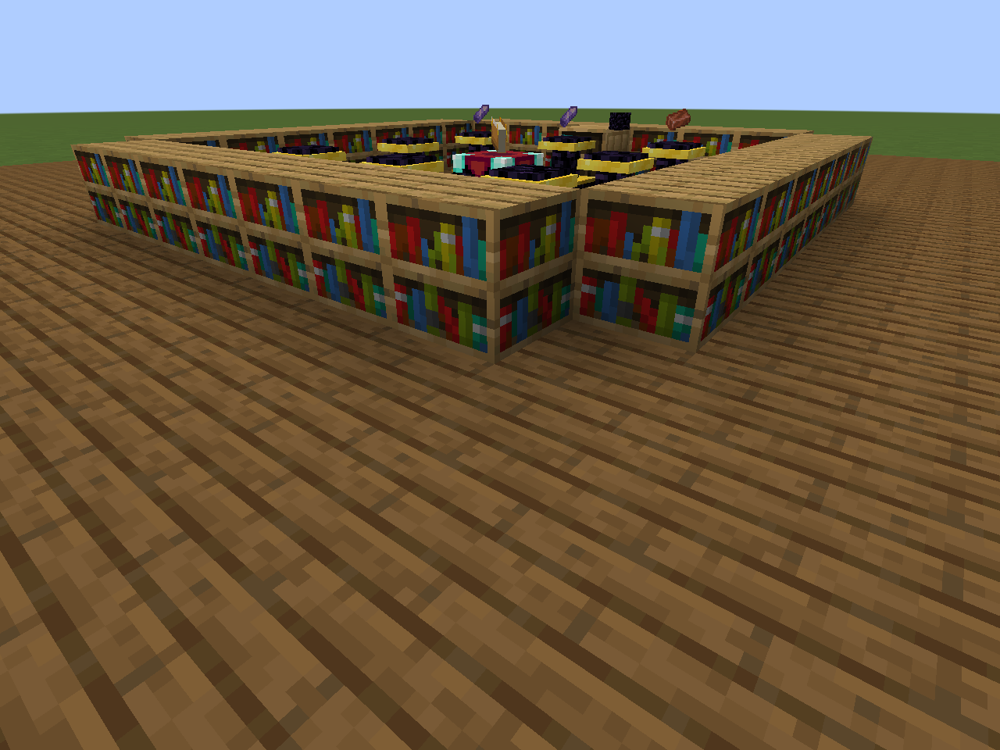
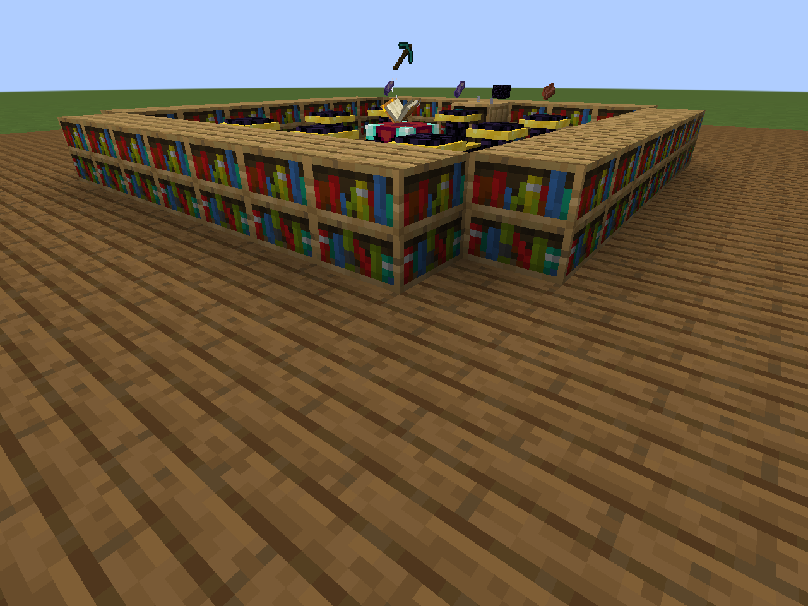
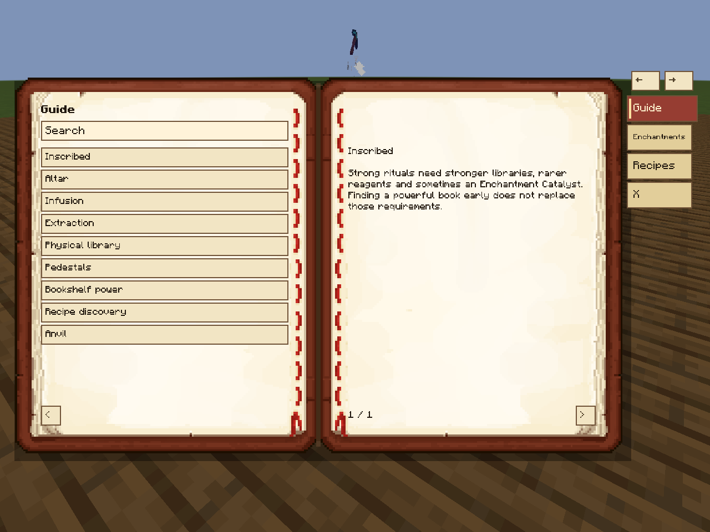
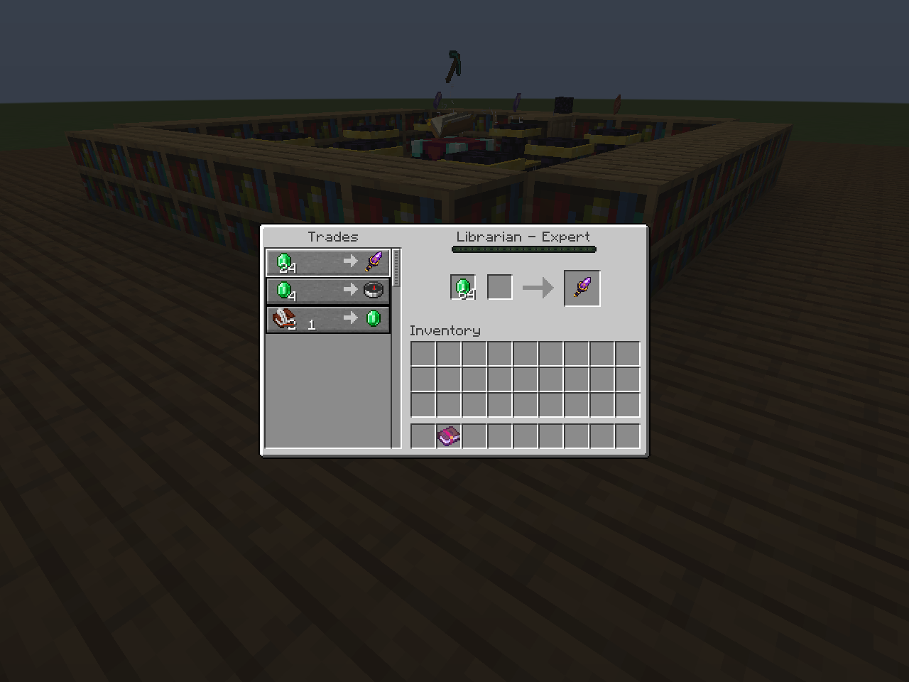

# Inscribed

**Build a library. Prepare your reagents. Inscribe your equipment.**

Inscribed turns enchanting into a physical craft built around enchanted books, a working library and rituals at the Enchanting Table. Books become knowledge you can find, store and put to use. A stronger enchantment asks for a better library and rarer materials, giving exploration and your enchanting room a continuing purpose.

Prepared release: **0.8.0** · **Minecraft 1.21.1** · **NeoForge 21.1.255+** · **Java 21** · **MIT**

[Português do Brasil](https://github.com/tpessotti/Inscribed/blob/main/docs/README.pt-BR.md) · [Add enchantments](https://github.com/tpessotti/Inscribed/blob/main/docs/ADDING_ENCHANTMENTS.md) · [Configuration](https://github.com/tpessotti/Inscribed/blob/main/docs/INSCRIBED_CONFIGURATION.md) · [Changelog](https://github.com/tpessotti/Inscribed/blob/main/CHANGELOG.md) · [Issues](https://github.com/tpessotti/Inscribed/issues)



## The idea

An enchanted book is a physical reference. Keep it in a nearby Chiseled Bookshelf, place an item on your Enchanting Table and supply the recipe's reagents on Infusion Pedestals. Ordinary Bookshelves provide the power your altar needs. Advanced recipes add an Enchantment Catalyst and increasingly demanding materials.

The altar's floating items, ritual effects and sounds show what is happening. Its guide explains the process and the enchantments you have discovered. Infusion and extraction use their own recipes and risks, so copying knowledge and recovering a book are decisions you can plan around.

## What you can do

- **Infuse enchantments** into compatible equipment using a matching physical reference book.
- **Extract an enchantment** from equipment into a book while preserving the item's other enchantments and components.
- **Build a physical library** using Chiseled Bookshelves for reference books and empty books.
- **Prepare up to eight reagents**, one item per Infusion Pedestal.
- **Find catalysts in structure loot** or buy them from qualified Librarians. Both sources have independent switches.
- **Explore a data-driven catalog** of 125 vanilla-enchantment recipes and six additional recipes when Create is installed.
- **Customize recipes and loot** through datapacks and JSON overlays, including enchantments registered by other mods.



## Getting started

1. Install the matching Inscribed JAR on the client and server. NeoForge and Java are required; optional integrations are listed below.
2. Craft an **Inscribed Guide** with a book and an amethyst shard. Read the setup and recipe information in game.
3. Set up an Enchanting Table, ordinary Bookshelves and a nearby Chiseled Bookshelf.
4. Put a matching enchanted book in the Chiseled Bookshelf. Right-click the table with your target item.
5. Place each reagent on a separate Infusion Pedestal. Shift + right-click the table with an empty hand to begin. If several infusions match, choose the one you want.
6. Retrieve the finished target with an empty main hand.

Default horizontal ranges are five blocks for bookshelves/library and four blocks for pedestals; the vertical range is two blocks. Pedestals hold one item each. A stronger reference book can authorize a weaker recipe unless that recipe requires an exact book level; the result still uses the recipe's level.

Rituals use reagents and physical books instead of XP or lapis as a universal cost. A recipe may still request lapis as an ingredient. Infusion can consume its reference book according to that recipe's chance.

### Extracting an enchantment

Place the enchanted target on the table, supply the extraction reagents and put empty books in the Chiseled Bookshelf. The reagents select the enchantment to extract. Adjust them if several extractions match.

**Default extraction recipes have a 20% failure chance.** A failed extraction consumes the reagents and empty book, removes the selected enchantment and produces no enchanted book. Cancellation consumes nothing. Other enchantments remain on the target.

By default, anvil operations cannot transfer or merge enchantments; repairs and renaming that preserve the base item's enchantments remain available. This restriction is configurable.



## Obtaining an Enchantment Catalyst

`inscribed:enchantment_catalyst` is a reagent consumed by recipes that require it. Basic rituals do not require a catalyst.

| Source | Default behavior |
| --- | --- |
| Intermediate structure loot | 7% additional roll: shipwreck treasure, buried treasure, mineshafts, dungeons, outposts, jungle temples and desert pyramids |
| Advanced structure loot | 14% additional roll: strongholds, woodland mansions and regular Trial Chamber reward tables |
| Treasure loot | 22% additional roll: Ancient Cities, End Cities, bastion treasure and ominous Trial Chamber rewards |
| Librarians | One extra offer from Expert level onward: 24 emeralds for one catalyst; four uses per restock |

Treasure rolls award one catalyst 95% of the time and two 5% of the time. Other defaults award one. Loot is additive. Existing generated chests are not refilled. Vanilla trade discounts, demand and restocking apply to the Librarian offer.



Configure the active `inscribed-server.toml` used by your server/world:

```toml
[loot]
enable_loot_injection = true
enable_catalyst_loot = true

[trades]
enable_catalyst_trade = true
catalyst_librarian_level = 4
catalyst_emerald_cost = 24
catalyst_max_uses = 4
```

Set either catalyst switch to `false` to disable that source independently. The global loot switch also controls all Inscribed loot injections. Disabling trades marks existing Librarian catalyst offers unavailable and blocks pending purchases; re-enabling preserves their saved stock/history. Reopen an existing trade window to refresh its displayed availability. Price and stock settings apply when a new offer is created.

See [Catalyst details](https://github.com/tpessotti/Inscribed/blob/main/docs/INSCRIBED_CATALYST.md) and the [full configuration reference](https://github.com/tpessotti/Inscribed/blob/main/docs/INSCRIBED_CONFIGURATION.md). Customized recipe/loot JSON overlays are preserved on upgrade.

## Optional integrations

| Mod | Integration |
| --- | --- |
| JEI | Infusion and Extraction recipe categories |
| Create / Ponder | Animated altar setup tutorial; six conditional enchantment recipes |
| LSBC | Codex enchantment knowledge, word integration and magnifying-glass inspection |

Inscribed also works without these mods. Without LSBC, Book and Quill provides the altar inspection fallback. The standalone Guide is part of Inscribed itself. See [compatibility](https://github.com/tpessotti/Inscribed/blob/main/docs/INSCRIBED_COMPATIBILITY.md) for tested versions and limits.

## Add your own enchantments and recipes

Inscribed can use an enchantment already registered by Minecraft, a mod or a datapack. An Inscribed recipe defines its ritual; it does not create the enchantment's effect.

For a ready-to-edit, complete datapack, use [examples/add_enchantment](https://github.com/tpessotti/Inscribed/blob/main/examples/add_enchantment). It contains `pack.mcmeta` and an infusion/extraction recipe at:

```text
data/example/inscribed/enchantment_recipes/sharpness_1.json
```

The [step-by-step authoring guide](https://github.com/tpessotti/Inscribed/blob/main/docs/ADDING_ENCHANTMENTS.md) covers the full JSON, physical library requirements, modded enchantment IDs, optional-mod conditions, reloads and a working test checklist. [Documentação em português](https://github.com/tpessotti/Inscribed/blob/main/docs/ADDING_ENCHANTMENTS.pt-BR.md) is also available.

For advanced customization, use the [datapack reference](https://github.com/tpessotti/Inscribed/blob/main/docs/INSCRIBED_DATAPACK_AUTHORING.md), [JSON schemas](https://github.com/tpessotti/Inscribed/blob/main/schemas), [templates](https://github.com/tpessotti/Inscribed/blob/main/templates) and [modpack quickstart](https://github.com/tpessotti/Inscribed/blob/main/docs/INSCRIBED_MODPACK_QUICKSTART.md). Explicit JSON overlay entries take precedence over same-ID datapack recipes; use your own namespace for additions.


## License

Inscribed uses the MIT license. Development and some bundled assets used generative AI; see the source repository credits and platform disclosure requirements.
